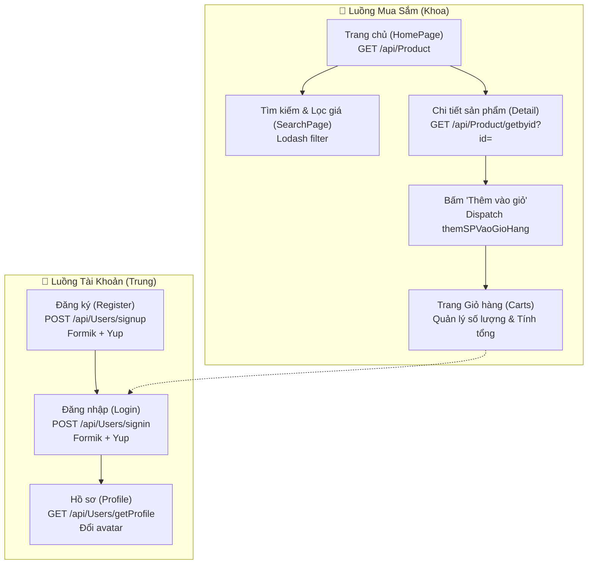

# 📋 Kế Hoạch Đồ Án Capstone ReactJS — Shoes Shop (BC97)

> [!IMPORTANT]
> - **Code mẫu tham khảo:** `reactjsbc97` (React 19, Vite, Bootstrap 5.3, Redux Toolkit, React Router v7, Axios, Formik + Yup, Lodash).
> - **Codebase thực thi:** `capstone-shoes-shop` (đã khởi tạo sẵn cấu trúc thư mục, dependencies và toàn bộ file skeleton có chú thích chi tiết).
> - **Figma:** [Shoes Shop Design](https://www.figma.com/file/HPyvaEJpBCxXB3p2r59nk6/Capstone)
> - **Swagger API:** [shop.cyberlearn.vn/swagger](https://shop.cyberlearn.vn/swagger/index.html)

---

## 👥 Phân Chia Nhiệm Vụ 2 Thành Viên

### 🧑‍💻 Thành viên 1: Hoàng Anh Khoa (Frontend Core, Navigation & Shopping)
| Mã Task | File phụ trách | Nhiệm vụ chi tiết | Kiến thức áp dụng |
|---|---|---|---|
| **K1** | `src/components/Header.jsx` | Xây dựng Header navbar responsive, Logo Shoes Shop, links điều hướng, badge giỏ hàng hiển thị số lượng SP | `NavLink`, `useSelector` |
| **K2** | `src/templates/HomeTemplate.jsx` | Ghép khung giao diện chung gồm Header, `<Outlet />` và Footer | `Outlet` (React Router) |
| **K3** | `src/pages/HomePage.jsx` | Call API danh sách giày, render card sản phẩm, nút "Thêm vào giỏ" dispatch Redux | `useEffect`, `useState`, `axios`, `useDispatch` |
| **K4** | `src/pages/Detail.jsx` | Nhận param `:id`, call API lấy chi tiết giày, chọn số lượng và thêm vào giỏ | `useParams`, `axios`, `useDispatch` |
| **K5** | `src/redux/store.jsx` & `cartReducer.jsx` | Xây dựng Redux store và Slice giỏ hàng với 4 action: thêm SP, xóa SP, cập nhật số lượng, xóa tất cả | `configureStore`, `createSlice` |
| **K6** | `src/pages/Carts.jsx` | Render bảng giỏ hàng từ Redux state, tăng giảm số lượng, xóa sản phẩm, tính tổng tiền | `useSelector`, `useDispatch`, Array `reduce` |
| **K7** | `src/pages/SearchPage.jsx` | Tìm kiếm giày theo từ khóa, lọc theo khoảng giá bằng Lodash (`_.filter`) | Lodash, Controlled Input |

---

### 🧑‍💻 Thành viên 2: Nguyễn Thành Trung (Design System, Auth & User Management)
| Mã Task | File phụ trách | Nhiệm vụ chi tiết | Kiến thức áp dụng |
|---|---|---|---|
| **T1** | `src/assets/css/**` | Cấu hình Design tokens (`_tokens.css`), Bootstrap overrides (`_base.css`), layout và header styles | CSS Variables, Bootstrap 5.3 utility classes |
| **T2** | `src/components/Footer.jsx` | Xây dựng Footer chân trang sạch sẽ, bản quyền, thông tin nhóm | React Functional Component |
| **T3** | `src/pages/Login.jsx` | Xây dựng form Đăng nhập có kiểm tra validation email & password, điều hướng sau đăng nhập | `useFormik`, `Yup`, `useNavigate` |
| **T4** | `src/pages/Register.jsx` | Xây dựng form Đăng ký đầy đủ trường (name, password, phone, gender: Nam/Nữ), call API POST signup | `useFormik`, `Yup`, `axios.post` |
| **T5** | `src/pages/Profile.jsx` | Hiển thị hồ sơ người dùng đăng nhập (tên, email, số điện thoại, avatar) và chức năng cập nhật | `useEffect`, `axios`, LocalStorage |
| **T6** | Toàn bộ trang | Rà soát tính thẩm mỹ UI/UX: không dư thừa nút, màu sắc hài hòa, chuẩn responsive Mobile/Desktop | UI/UX Guidelines, Bootstrap Grid |
| **T7** | Kiểm thử & Review | Phối hợp test luồng đăng ký → đăng nhập → xem SP → thêm giỏ → thanh toán | E2E Testing thủ công |

---

## 🎨 Thiết Kế & Quy Chuẩn UI/UX

### 1. Hệ thống màu sắc (Ocean Blue Theme)
- **Primary:** `#0078d4` (Nút bấm chính, link active, điểm nhấn)
- **Primary Dark (Hover/Active):** `#005a9e`
- **Surface (Nền Card/Bảng):** `#ffffff`
- **App Background:** `#f3f6fb` (Nền dịu mắt, tăng độ tương phản cho card)
- **Text Color:** `#1e1e1e` (Chữ chính)
- **Muted Text:** `#616161` (Mô tả, nhãn phụ)
- **Accent/Success:** `#00a67e` (Giá bán, thông báo thành công)
- **Danger:** `#dc2626` (Nút xóa, thông báo lỗi validation)

### 2. Font chữ & Typography
- **Font gia đình:** `Be Vietnam Pro` (đã cài qua `@fontsource/be-vietnam-pro`, hỗ trợ hoàn hảo tiếng Việt có dấu, không lỗi chân chữ).
- **Trọng số sử dụng:** 400 (Regular cho nội dung), 500 (Medium cho nhãn form), 700 (Bold cho tiêu đề và giá sản phẩm).

### 3. Nguyên tắc UI/UX
- Không dư thừa các nút hay câu chữ rườm rà.
- Trạng thái phản hồi rõ ràng: Loading spinner khi đang tải dữ liệu từ API; Empty state khi giỏ hàng trống hoặc tìm kiếm không ra kết quả; Error message màu đỏ rõ ràng dưới mỗi input khi validate sai.
- Chuẩn CSS Framework: Tận dụng các class Bootstrap 5.3 (`container`, `row`, `col-*`, `table`, `card`, `d-flex`, `gap-*`, `btn`, `form-control`) kết hợp biến CSS tokens.

---

## 🔄 Luồng Nghiệp Vụ Chính (Workflow)



---

## 📁 Cấu Trúc File & Bản Đồ Mã Nguồn (Code Graph)

```
📁 capstone-shoes-shop/
├── index.html
├── vite.config.js
├── package.json
├── docs/
│   ├── CODE_GRAPH.md                   ← Bản đồ kiến trúc dự án
│   └── PLAN.md                         ← Kế hoạch thực hiện dự án
└── src/
    ├── main.jsx                        ← Khởi tạo React 19, Provider, BrowserRouter
    ├── assets/
    │   └── css/
    │       ├── main.css                ← Import tập trung các file css
    │       └── styles/
    │           ├── _tokens.css         ← Biến màu, font, radius, shadow
    │           ├── _base.css           ← Overrides cho Bootstrap
    │           ├── _layout.css         ← Căn chỉnh lề, chiều cao layout
    │           └── _header.css         ← Navbar & Cart badge
    ├── components/
    │   ├── Header.jsx                  ← [Khoa] Navbar, menu, cart badge
    │   └── Footer.jsx                  ← [Trung] Footer chân trang
    ├── templates/
    │   └── HomeTemplate.jsx            ← [Khoa] Header + <Outlet /> + Footer
    ├── pages/
    │   ├── HomePage.jsx                ← [Khoa] Grid sản phẩm từ API
    │   ├── SearchPage.jsx              ← [Khoa] Tìm kiếm + filter lodash
    │   ├── Detail.jsx                  ← [Khoa] Xem chi tiết theo id + add cart
    │   ├── Carts.jsx                   ← [Khoa] Bảng giỏ hàng Redux
    │   ├── Login.jsx                   ← [Trung] Formik + Yup đăng nhập
    │   ├── Register.jsx                ← [Trung] Formik + Yup đăng ký (gender bool)
    │   └── Profile.jsx                 ← [Trung] Thông tin cá nhân & avatar
    └── redux/
        ├── store.jsx                   ← [Khoa] configureStore
        └── reducers/
            └── cartReducer.jsx         ← [Khoa] Reducer giỏ hàng
```

---

## 📡 Chi Tiết Đặc Tả API

Base URL: `https://shop.cyberlearn.vn` (từ tài liệu CyberLearn Capstone)

| STT | Endpoint | Method | Dữ liệu gửi lên | Dữ liệu nhận về | Người gọi API |
|---|---|---|---|---|---|
| 1 | `/api/Product` | `GET` | Không | `content`: Danh sách tất cả sản phẩm giày | Khoa |
| 2 | `/api/Product/getbyid?id={id}` | `GET` | Query param `id` | `content`: Chi tiết sản phẩm, kích cỡ, mô tả | Khoa |
| 3 | `/api/Users/signup` | `POST` | `{ name, password, phone, gender }` | Thông tin tài khoản đăng ký thành công | Trung |
| 4 | `/api/Users/signin` | `POST` | `{ email, password }` | `{ accessToken, ... }` | Trung |
| 5 | `/api/Users/getProfile` | `GET` | Bearer Token qua Header | Thông tin chi tiết user | Trung |

---

## 🛒 Đặc Tả State Giỏ Hàng (Redux Toolkit)

```javascript
// State ban đầu trong cartReducer.jsx
initialState = {
  mangSanPham: [] // Mảng các object: { id, name, image, price, soLuong }
}
```

**Các Actions xử lý:**
1. `themSPVaoGioHang(sp)`: Tìm xem SP có `id` trùng chưa. Nếu có tăng `soLuong += 1`, nếu chưa thêm mới với `soLuong = 1`.
2. `xoaSPKhoiGioHang(id)`: Lọc bỏ SP có `id` khỏi mảng.
3. `capNhatSoLuong({ id, soLuong })`: Cập nhật lại số lượng cho đúng `id`.
4. `xoaTatCa()`: Xóa sạch giỏ hàng (`mangSanPham = []`).

---

## ✅ Kế Hoạch Kiểm Thử (Test Checklist)

| STT | Chức năng cần test | Kịch bản kiểm tra | Kết quả mong đợi | Phụ trách |
|---|---|---|---|---|
| 1 | **Hiển thị sản phẩm** | Vào trang `/` | Load danh sách sản phẩm từ API, hiển thị ảnh, tên, giá | Khoa |
| 2 | **Xem chi tiết** | Click vào sản phẩm | Điều hướng tới `/detail/:id`, hiển thị đúng dữ liệu | Khoa |
| 3 | **Thêm vào giỏ** | Click nút "Thêm vào giỏ" ở trang Home hoặc Detail | Số trên Cart badge ở Header tăng lên | Khoa |
| 4 | **Quản lý giỏ hàng** | Vào `/carts` thay đổi số lượng, click xóa | Tổng tiền và số lượng cập nhật ngay lập tức | Khoa |
| 5 | **Tìm kiếm & Lọc** | Nhập từ khóa, lọc theo giá | Kết quả lọc đúng bằng Lodash, không crash trang | Khoa |
| 6 | **Validate Đăng nhập** | Bỏ trống form, nhập email sai cú pháp | Báo lỗi đỏ tương ứng, không cho submit | Trung |
| 7 | **Đăng ký tài khoản** | Nhập đủ tên, pass, phone, chọn giới tính | Gửi dữ liệu hợp lệ lên API signup, chuyển về login | Trung |
| 8 | **Responsive** | Co dãn trình duyệt (mobile 375px, tablet 768px, desktop) | Giao diện tự động co giãn ngay ngắn, menu thu gọn | Trung |

---

## 🚀 Hướng Dẫn Bắt Đầu Dành Cho 2 Bạn

1. **Khởi chạy ứng dụng:**
   ```bash
   cd d:\_cybersoft\_cybersoft\capstone-shoes-shop
   npm run dev
   ```
2. **Quy trình làm việc:**
   - Mỗi file đã có sẵn chú thích **`👤 NGƯỜI LÀM`**, **`📌 NHIỆM VỤ`**, **`HƯỚNG DẪN TỪNG BƯỚC`** và **`THAM KHẢO CODE MẪU BC97`**.
   - Mở từng file được phân công, đọc ghi chú và bắt tay vào hiện thực các hàm xử lý.
   - Thường xuyên chạy `npm run build` để kiểm tra không bị lỗi cú pháp trước khi chuyển giao.
